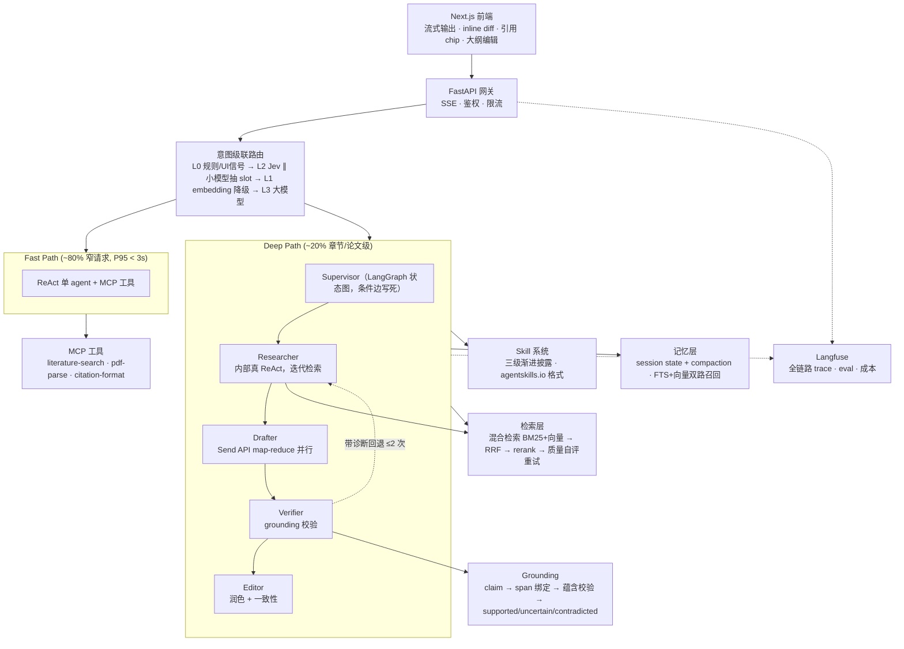

# Academic Research Copilot

面向学生的**科研写作辅助** Agent —— 文献检索、综述、大纲、引用管理、润色、修改建议。

> **产品边界**：辅助，不代写。不做整篇代写、不做降重。越界请求会被路由层识别并拒绝。
> 所有输出强制绑定真实文献 span，未获支持的引用会被标记。

一个用于展示 Agent 工程能力的独立项目：显式状态图编排、引用可信度校验、评测驱动开发、全链路可观测。

---

## 架构



**核心设计判断**

- **快慢双路径**：80% 的请求是窄任务，不该跑完整 pipeline。两条路径共享同一套工具与 RAG 管线。
- **Supervisor 是图不是 LLM**：论文写作是有依赖的流水线。状态转移写死在 conditional edges，LLM 只在节点内部工作 —— 可复现、可审计、可调试。
- **子 agent 通过 typed State 通信**，从不直接对话。传裁剪过的 view 而非整个 state；上下文隔离是拆子 agent 的唯一正当理由。
- **引用必须可验证**：每条 claim 绑定到检索时的精确 span，蕴含校验不通过则标红并带诊断回退重检索。
- **Skill 不允许 agent 自己改**：只能通过 PR 修改，改 frontmatter 必须过 routing eval 的 CI 门禁。与 Hermes Agent 的自我改进闭环相反 —— 在需要审计的垂直场景，可控性优先于灵活性。

---

## 技术栈

| 层 | 选型 |
|---|---|
| 前端 | Next.js 16 · React 19 · TypeScript · Tailwind 4 · Vercel AI SDK |
| 网关 | FastAPI · SSE |
| 编排 | LangGraph 1.2 · SqliteSaver/PostgresSaver checkpoint · human-in-the-loop interrupt |
| 语言模型 | DeepSeek（OpenAI 兼容，改 `LLM_BASE_URL` 即可换 provider）· `deepseek-flash` 承接 Fast Path 与工具调用 · `deepseek-v4-pro` 承接 Deep Path 推理节点 |
| 决策模型 | TypeSafe AI Jev（意图路由 / grounding 蕴含校验 / 注入检测） |
| 检索 | 本地 `sqlite-vec` + FTS5 `bm25()` → 部署 pgvector HNSW + `tsvector` · RRF 融合 · cross-encoder rerank |
| 工具协议 | MCP |
| 可观测 | Langfuse（Week 1–3 用 Cloud，Week 4 自托管） |
| 数据源 | OpenAlex · Semantic Scholar · Crossref · arXiv |
| 基础设施 | Docker Compose · GitHub Actions |

---

## 本地启动

**零外部服务**：默认配置下不需要 Docker、不需要 Postgres、不需要 Redis。克隆下来即可跑。

### 0. 前置

```bash
node -v        # >= 22
pnpm -v        # >= 10
uv --version   # >= 0.11
```

Python 由 uv 管理，**锁定 3.12**（见 `.python-version`）。系统装的 3.14 太新，LangGraph 生态还没有对应 wheel。

### 1. 配置

```bash
cp .env.example .env                     # 填入 API key
cp apps/web/.env.local.example apps/web/.env.local
```

### 2. 装依赖

```bash
uv sync --all-packages     # ★ 必须带 --all-packages
pnpm --dir apps/web install
```

> **`uv sync` 不带 `--all-packages` 只会装 workspace 根的依赖（空的），四个成员都不会被安装。**

> **装完之后就固定用 `--no-sync` 跑命令**（见下一节）。原因：`--all-packages` 解析的是全 workspace 依赖并集，`--package api` 解析的只是 api 的依赖，两者的 websockets 版本约束不同（langgraph 要 <17，uvicorn[standard] 允许 >=17）。交替使用会让 uv 反复装卸同一个包，在 Windows 上撞上 DLL 文件锁就会把 `.venv` 装坏（出现两个 dist-info、缺 RECORD 文件）。
>
> **规则：`uv sync --all-packages` 只在依赖变更时手动跑；平时一律 `uv run --no-sync ...`。**
>
> 如果 `.venv` 已经坏了：`rm -rf .venv && uv sync --all-packages` 重建即可，`uv.lock` 保证可复现。

> Windows 上如果 uv 每次打印 `Failed to hardlink files`，是因为项目在 `E:` 而缓存在 `C:`，跨盘无法硬链接。设 `UV_LINK_MODE=copy` 消除警告（只是变慢，不影响正确性）。

### 3. 起服务

```bash
# 终端 A — 后端
uv run --no-sync --package api uvicorn api.main:app --reload --port 8000

# 终端 B — 前端
pnpm --dir apps/web dev
```

打开 http://localhost:3000 ，右上角徽章显示 `api online` 即为打通。
`curl localhost:8000/health` 会回报当前使用的存储后端。

> **`uv add` 之前必须先停掉 uvicorn。** 运行中的进程会锁住 `.venv` 里的 `.pyd`/`.dll`，Windows 无法删除已加载的动态库（POSIX 可以），表现为 `拒绝访问 (os error 5)`，并把环境留在半装状态。

### 4.（可选）起基础设施

只在把后端切到 `postgres` / `redis` / `s3` 时才需要，属于 **Week 4 部署**范畴：

```bash
docker compose -f infra/docker-compose.yml up -d
```

提供 PostgreSQL 17 + pgvector（:5432）、Redis 7（:6379）、MinIO（:9000 API / :9001 控制台）。

---

## 存储后端：local-first，可切换

`packages/agent/src/paper_agent/storage.py` 里每个后端都有本地实现和生产实现，靠环境变量切换，**业务代码只依赖返回的对象，切换不需要改任何调用点**。

| 用途 | 环境变量 | 本地默认 | 生产 |
|---|---|---|---|
| LangGraph checkpoint | `CHECKPOINT_BACKEND` | `sqlite` → `data/checkpoints.sqlite` | `postgres`（PostgresSaver） |
| Jev 决策缓存 | `CACHE_BACKEND` | `memory`（LRU+TTL，单进程） | `redis` |
| PDF / 附件 | `BLOB_BACKEND` | `local` → `data/blobs/` | `s3`（MinIO） |

`memory` 也可用于 checkpoint，重启即丢，调试单次流程时更快。

**为什么这么设计**：Docker 是部署问题，不是开发前置条件。把 `docker compose up` 当成 Week 1 的必需品，会让本地开发平白多出一层摩擦。

### Week 3 检索后端：已定 —— 本地 SQLite，部署 pgvector

本地检索栈**不依赖 Postgres**，已实测跑通（SQLite 3.50.4）：

| 检索环节 | 本地实现 | 部署实现 |
|---|---|---|
| 向量召回 | `sqlite-vec` 0.1.9 的 `vec0` 虚表 | pgvector HNSW |
| 关键词召回 | SQLite FTS5 + `bm25()` | Postgres `tsvector` |
| 融合 | RRF（`k=60`） | 同 |

> **为什么不用本机的 PostgreSQL 16**：机器上确实装了 PG（`D:\PostgreSQL\16`），但它被从 `C:\Program Files\PostgreSQL\16` 整体搬迁过，当前无法启动 —— `icudt67.dll`（ICU 数据库，约 28MB）在搬迁中丢失，导致 `postgres.exe` 以 `0xC0000135` 退出；Windows 服务的 `ImagePath` 也仍指向已不存在的 C 盘路径。
>
> 更关键的是：**即使修好 ICU，pgvector 仍然缺失**。pgvector 官方不提供 Windows 预编译包，只支持 `nmake /F Makefile.win` 源码编译，而这台机器上没有 Visual Studio / `cl.exe` / `nmake.exe`。装 Build Tools 再编译要半天到一天，而 Week 3 的价值全在检索**设计**（hybrid → RRF → rerank → 质量自评估）上，不在向量存在哪个引擎里。
>
> 所以本地走 SQLite，`storage.py` 已预留切换点，Week 4 用 `docker compose up` 起 `pgvector/pgvector:pg17` 后改环境变量即可。

> **一个会咬人的细节**：SQLite 的 `bm25()` 返回**负数**（越负越相关），`ORDER BY bm25(t)` 是升序。它不是经典 BM25 的正分。因为我们用 RRF 融合，**只消费排名不消费分值**，这个差异无害 —— 这也正是选 RRF 而不是加权分数融合的原因：BM25 无界、余弦相似度在 `[-1,1]`，直接加权本就脆弱。

---

## 目录

```
apps/
  api/                     FastAPI 网关
  web/                     Next.js 前端
packages/
  agent/                   ★ LangGraph 编排核心
    src/paper_agent/
      graph/                 state · nodes · builder
      routing/               DecisionModel 抽象 · Jev backend · 级联
      retrieval/             (Week 3) 混合检索 · rerank · chunking
      grounding/             (Week 2) ★ claim→span 绑定 · 蕴含校验
      tools/                 进程内工具
      prompts/
  mcp-servers/
    literature-search/     MCP: OpenAlex / Semantic Scholar / CSL
  evals/                   ★ 数据集 + runner
    data/routing.jsonl       意图路由 eval（含歧义样本与负样本）
infra/
  docker-compose.yml
  migrations/
skills/                    SKILL.md，遵循 agentskills.io 格式
  third_party/             vendored 第三方 skill（Apache-2.0）
    LICENSE · NOTICE · PROVENANCE.md
docs/
  PLAN-WEEK1.md            逐日计划、退出标准、坑速查
  devlog.md                每日三行
```

---

## 评测

| 维度 | 指标 |
|---|---|
| 意图路由 | Accuracy · Macro-F1 · 各意图召回率 · **false-positive rate** |
| 引用可信度 | **Citation Precision** · **Citation Recall** |
| 端到端 | 事实一致性 · 指令遵循 |

```bash
# 全量：storage / config / API 契约（含 SSE 分帧）/ routing 数据 / vendored skill 完整性
uv run --no-sync pytest -q

# 只跑 routing eval
uv run --package evals pytest packages/evals
```

CI 门禁：修改任何 `SKILL.md` 的 frontmatter 或路由 prompt，必须跑 routing eval。
理由：description 是自然语言，随手改一个词就可能让兄弟 skill 抢走流量。

---

## 开发计划

| 周 | 目标 |
|---|---|
| **Week 1** | 骨架跑通 + trace 可见 → [docs/PLAN-WEEK1.md](docs/PLAN-WEEK1.md) |
| Week 2 | 状态图 + checkpoint + HITL + **grounding 校验** |
| Week 3 | 检索质量 + 长期记忆 + 前端审阅体验 |
| Week 4 | **评测体系** + 安全加固 + 部署 + 包装 |

---

## 后续规划（刻意不在一个月内做）

- **GraphRAG / 引用网络图谱** — 对"领域方法演进"类问题有价值，但一个月做不完，且对本场景 ROI 低于 grounding 与 eval。
- **偏好数据 → DPO / reranker 微调** — 前端已埋「接受 / 拒绝修改建议」的点，数据从 Week 3 开始积累。
- **本地小模型档位** — 用 Qwen3 或 Hermes 模型承接 claim 抽取、slot 抽取等高频低难度调用，进一步降本。
- **用户自定义 skill 安装** — skill 可携带脚本，第三方 skill 等于任意代码执行。需要先有沙箱与审计，因此当前只允许内置 skill。上游 `nature-academic-search/install.sh` 是一个留档标本（见 PROVENANCE.md）：不 pin 依赖、自动改写宿主配置自我启用。
- **多租户与权限体系** · **Langfuse 自托管** · **代码执行沙箱**

---

## 安全

- 检索回来的论文内容是**不可信输入**，可能包含针对 AI 的注入指令。每个 chunk 入库/召回时过注入检测，命中则剔除或降级标记。
- 工具白名单；MCP server 独立进程，不与网关共享内存。
- 学术诚信边界在路由层强制：整篇代写、降重类请求识别后拒绝并引导至辅助功能。
- **vendored 第三方 skill 走「已审查文件白名单」而非黑名单扫描**：新增任何 `.py` 都会让测试失败，强制重新逐行审查。见下节。
- `.env` 永不提交；仓库内只有 `.env.example`。

---

## 第三方 skill 与许可

领域知识（Nature 风格写作范式、统计报告规范、参考文献校验启发式）**不从零自造**，
vendored 自 [Nature Skills](https://github.com/Yuan1z0825/nature-skills)（Apache-2.0）。
完整归属、上游 commit、逐条排除理由见
[`skills/third_party/NOTICE`](skills/third_party/NOTICE) 与
[`skills/third_party/PROVENANCE.md`](skills/third_party/PROVENANCE.md)。

上游 23 个 skill，只 vendor 6 个（996 KB / 123 文件）：

| skill | 上游成熟度 | 可执行代码 | 对应能力 |
|---|---|---|---|
| `nature-shared` | 基础设施 | 2 | 其余五个的共享引用包 |
| `nature-polishing` | Stable | 0 | 润色 |
| `nature-statistics` | Draft | 0 | 处理数据（统计表述层） |
| `nature-social-science` | Draft | 0 | 提供思路 |
| `nature-ref-verifier` | Stable | 0 | Citation Precision / grounding |
| `nature-response` | Beta | 3 | 审稿意见逐点回复 |

**Skill 是知识，不是能力。** 路由、grounding、评测三件事必须无可争议是自研的——
一个 skill 包替代不了它们，本项目也不允许把它当作替代品。

### 三道门禁

`packages/agent/tests/test_vendored_skills.py`（17 项，全部做过反向验证确认真的会失败）：

1. **已审查文件白名单** —— 5 个 `.py` 逐个读过，纯 stdlib（`argparse/json/re/sys/dataclasses/decimal/pathlib/typing`），无网络、无 `subprocess`、无 `eval/exec`、不读环境变量。白名单外的新文件直接 fail。
2. **兄弟路径解析** —— vendored skill 用 `../nature-shared/core/*.md` 引用共享材料，12 条引用**只在六个目录互为兄弟时才成立**。目录结构一变深就会在 prompt 组装期静默失效（表现为输出质量下降，而非报错）。
3. **格式化工具不得触碰** —— `NOTICE` 声明「verbatim copies」，`ruff format` 改一个空格就让该声明失效并触发 Apache-2.0 §4(b) 的修改声明义务。`extend-exclude` **不够**：它只在从根遍历时生效，编辑器 format-on-save 或 `ruff format skills/` 传显式路径会绕过。必须配 `force-exclude = true`，且两者都有测试守着。

### 明确排除

- **`nature-downloader`** —— 借用户的 Chrome 登录态与 CARSI / Web of Science 入口获取付费全文。产品化不可接受。
- **`nature-academic-search/install.sh`** —— 不 pin 依赖 `pip install`、自动改写宿主 agent 的 `.mcp.json` 与 `settings.json` 自我启用、shell 参数直插 Python heredoc。这是「第三方 skill = 任意代码执行」的具体标本，PROVENANCE.md 里留档，**永不执行**。
- **`nature-figure`** —— 34 MB / 129 文件，主要是示例绘图脚本。
- **`nature-suite`** —— 只存在于本机安装副本（上游仓库没有，且该副本无 LICENSE、来源不明）。且它本身是个 router，会与自研意图级联冲突。**永不 vendor 第二个 router。**
- **`nature-writing`** —— 其 Core stance 与本项目「辅助不代写」边界一致，但 description 覆盖 draft "full manuscript argument"。若引入，必须由**本项目的路由层**收窄到 section-level + 强制作者提供 claims。边界由我们守，不交给 skill。

